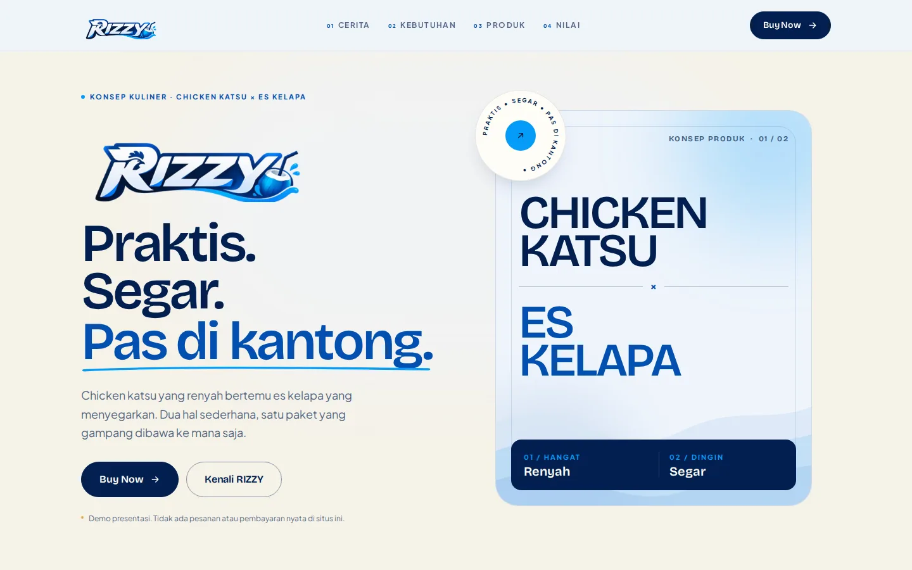
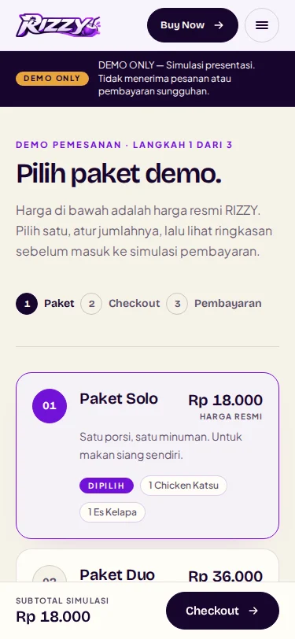
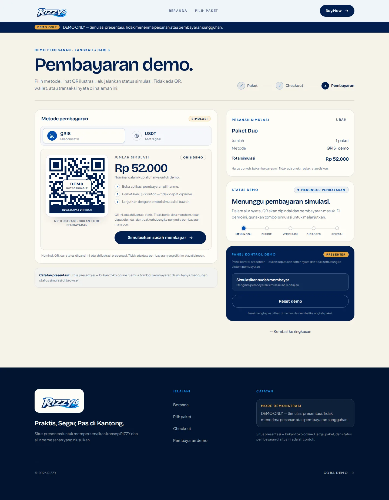

# RIZZY — Presentasi & Demo Pemesanan

Situs presentasi statis untuk konsep **RIZZY — Chicken Katsu + Es Kelapa**
dengan alur pemesanan dan pembayaran yang **sepenuhnya disimulasikan**.

> **DEMO ONLY — Simulasi presentasi. Tidak menerima pesanan atau pembayaran sungguhan.**

Tidak ada backend, database, autentikasi, payment gateway, analytics, API eksternal,
penyimpanan permanen, atau transaksi nyata di proyek ini.

**Live:** https://forsha7class.github.io/rizzy/



## Stack

- React 19 + TypeScript
- Vite 8 dengan `base: './'` untuk GitHub Pages
- Tailwind CSS 4 (token di `src/styles/globals.css`)
- Motion for React
- Fontsource: Bricolage Grotesque + Plus Jakarta Sans (self-hosted)
- Vitest + Testing Library
- Playwright + axe-core

## Menjalankan

```bash
npm install
npm run dev          # http://localhost:5173
npm run build        # typecheck + production build ke dist/
npm run preview      # menyajikan dist/
```

## Rute

Routing memakai hash agar tidak memerlukan rewrite server.

| Hash | Halaman |
| --- | --- |
| `#/` | Landing / presentasi brand |
| `#/order` | Pilih paket dan jumlah (demo) |
| `#/checkout` | Ringkasan pesanan (demo) |
| `#/payment` | QRIS/USDT simulasi + status |
| hash lain | Halaman tidak ditemukan |

Refresh atau membuka tautan langsung ke `#/checkout` dan `#/payment` **kehilangan
pesanan** secara sengaja karena state hanya hidup di memori. Halaman akan menampilkan
empty state yang aman, bukan error.

## Alur simulasi

```
idle → awaiting → submitted → verified → processing → completed
                     ├→ underpaid ─┐
                     └→ overpaid ──┴→ submitted (ulangi pembayaran)
apa pun → idle (Reset demo)
```

- Status tidak pernah berubah otomatis dan tidak acak.
- `underpaid`/`overpaid` menahan pesanan dan menampilkan selisih simulasi.
- `verified` menjelaskan bahwa sistem nyata memerlukan verifikasi admin.
- Panel kontrol di halaman pembayaran adalah kontrol presenter, bukan admin.
- Tombol **Reset demo** menghapus pilihan di memori dan kembali ke `#/order`.

QRIS dan USDT hanya ilustrasi lokal. QR memakai artwork yang disediakan, diwarnai ulang
ke palet ungu, dan ditutup di bagian tengah sehingga tidak dapat dipindai. Tidak ada
payload, alamat wallet, jaringan, merchant, atau kurs real-time. Nilai USDT memakai
kurs ilustrasi yang bisa diubah di `src/config/demo-payment.ts`.

## Konfigurasi

| File | Isi |
| --- | --- |
| `src/config/demo-catalog.ts` | Nama paket, isi, dan **harga resmi** |
| `src/config/demo-payment.ts` | Metode, kurs USDT ilustrasi, nominal kurang/lebih |
| `src/config/site.ts` | Nama, tagline, teks notice demo, navigasi |
| `src/content/landing.ts` | Seluruh copy landing |
| `src/content/demo-status.ts` | Copy status dan tombol simulasi |
| `src/lib/pricing.ts` | Perhitungan subtotal/total murni |
| `src/lib/demo-machine.ts` | State machine deterministik |

Harga resmi saat ini: Solo **Rp18.000**, Duo **Rp36.000**, Rame **Rp72.000**.
Perubahan harga cukup dilakukan di catalog; alur pemesanan tetap simulasi.

## Aset

- Asli yang diunggah tetap utuh di `assets-upload/` (tidak diubah).
- Turunan web ada di `public/assets/`:
  - `brand/logo-full`, `logo-wordmark` (PNG + WebP), monogram, favicon, OG image
  - `brand/qris.svg` dan `brand/usdt.svg` — official marks untuk identifikasi metode
  - `payment/qris-card` dan `payment/usdt-card` (PNG + WebP) — QR artwork ungu
  - `product/katsu.jpg` + `katsu-900.jpg` (foto produk asli, crop 4:5)
  - `team/team.jpg` (foto tim, crop lebar)
- Foto produk dipakai satu kali sebagai bukti visual; bukan hero full-bleed.
- Tidak ada foto stok atau gambar makanan hasil AI.

## Verifikasi terakhir

Lingkungan: Node 24, Chromium headless, preview produksi lokal, 22 Oktober 2026.

| Pemeriksaan | Hasil |
| --- | --- |
| `npm run typecheck` | lulus |
| `npm run lint` | lulus, 0 error |
| `npm test` | 29 tes lulus (5 file) |
| `npm run test:e2e` | 44 lulus, 4 dilewati (tes khusus mobile pada project tablet/desktop) |
| axe-core (landing, order, checkout, payment, submitted) | 0 pelanggaran serious/critical |
| `npm run verify:pages` | **PASSED** dari subpath `/rizzy/` |
| Live GitHub Pages | **https://forsha7class.github.io/rizzy/** — HTTP 200, smoke test desktop/mobile lulus |
| Lighthouse mobile | Performance **93** (run bersih), Accessibility **100**, Best Practices **100**, SEO **100** |
| Lighthouse desktop | Performance **100**, Accessibility **100**, Best Practices **100**, SEO **100** |
| Build | JS ±133 kB gzip, CSS ±13,3 kB gzip |

Lighthouse dijalankan pada landing page. Skor dapat berbeda tergantung perangkat,
jaringan, dan versi Lighthouse. E2E juga memeriksa:

- tidak ada request eksternal dan tidak ada localStorage/sessionStorage/cookie;
- QR tidak memuat pola alamat wallet atau payload pembayaran;
- tidak ada horizontal overflow pada 375/768/1440 px;
- menu mobile bisa dibuka, ditutup dengan Escape, dan mengembalikan fokus;
- refresh/deep-link aman.

## GitHub Pages

**Live:** https://forsha7class.github.io/rizzy/  
**Repo:** https://github.com/forsha7class/rizzy  
**Source:** branch `main` · **Deploy:** branch `gh-pages` (build statis `dist/`)

Deployment saat ini memakai branch `gh-pages`, bukan GitHub Actions, karena token
GitHub yang tersedia saat deploy hanya memiliki scope `repo`. Halaman tetap sepenuhnya
statis dan `base: './'` membuat build aman di subpath repo.

Untuk memperbarui situs setelah perubahan source:

1. `npm run build`
2. Ganti isi branch `gh-pages` dengan isi `dist/`, lalu push.
3. Pastikan `.nojekyll` ikut ter-push.

Workflow GitHub Actions tetap disimpan sebagai referensi di
`docs/optional-github-actions.yml`. Workflow itu butuh token dengan scope `workflow`
(tidak dimiliki token deploy saat ini) dan belum aktif.

`public/.nojekyll` mencegah pemrosesan Jekyll. `og:image` kini memakai URL absolut
`https://forsha7class.github.io/rizzy/assets/brand/og-image.jpg`.

## Dokumentasi

- [PRD](docs/PRD.md)
- [Sitemap & flow](docs/SITEMAP.md)
- [Design system](docs/DESIGN_SYSTEM.md)
- [Implementation plan](docs/IMPLEMENTATION_PLAN.md)
- [Open questions & placeholders](docs/OPEN_QUESTIONS.md)
- [Verification report](docs/VERIFICATION.md)

## Screenshot

| Order di 375 px | Pembayaran di 1440 px |
| --- | --- |
|  |  |

## Batasan yang disengaja

- Harga paket resmi; isi paket mengikuti konfigurasi presentasi.
- Logo RIZZY yang tersedia hanya raster (PNG); belum ada SVG/AI/EPS. Mark QRIS dan
  Tether memakai SVG resmi untuk kebutuhan identifikasi.
- Hanya ada satu foto produk dan satu foto tim.
- Tidak ada data kontak, sosial media, alamat, testimoni, atau penghargaan yang dibuat-buat.
- Keranjang/ pesanan hilang saat refresh.
- QR tidak berfungsi dan USDT tidak memiliki alamat atau jaringan.
- Logo QRIS dan USDT/Tether digunakan hanya untuk identifikasi metode; tidak ada
  afiliasi atau endorsement yang tersirat.
